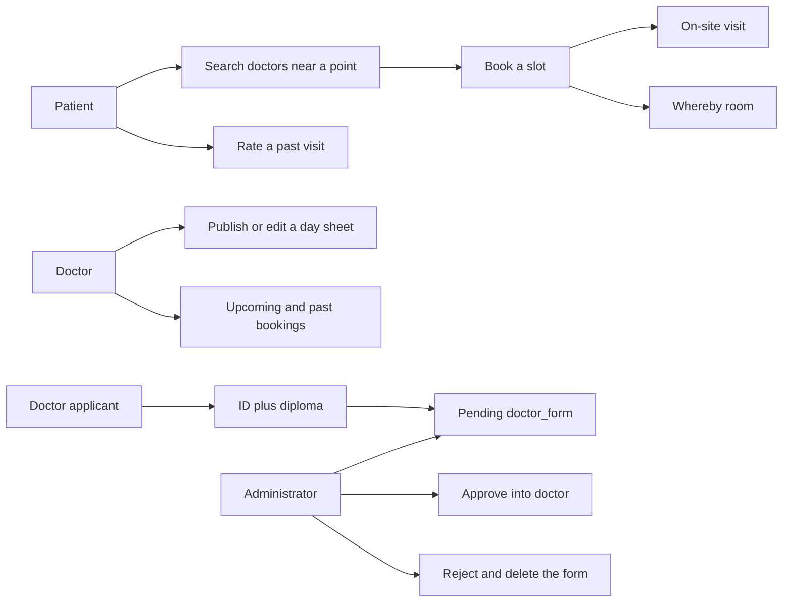

# Tabibi DZ

**Appointment API for patients and doctors in Algeria.**

Tabibi (طبيبي, “my doctor”) is the backend for a three-role clinic product: patients find a doctor and book a visit, doctors publish a day sheet and receive bookings, and an administrator approves new doctors. Identity for patients and doctors is taken from an Algerian national ID card. Remote visits open a Whereby room; on-site visits do not.

This repository is the API only. The frontend (`dz_tabib_frontend`) is gitignored and is not part of this tree. There is no checked-in database schema and no README was shipped with the code; the tables below are reconstructed from the SQL the views actually run.

| | |
| --- | --- |
| Author | Djoud El Hak Belkhir · [djihad-elhak](https://github.com/djihad-elhak) |
| Stack | Django 4.2, Django REST framework, MySQL, cookie JWT |
| Image | `djihadelhak/tabib:latest` |
| Host allowed in settings | `tabib.onrender.com` |

---

## Contents

- [What a client can do](#what-a-client-can-do)
- [Architecture](#architecture)
- [Repository layout](#repository-layout)
- [Data model](#data-model)
- [Authentication](#authentication)
- [API](#api)
- [Schedule slots](#schedule-slots)
- [Algerian ID parsing](#algerian-id-parsing)
- [Configuration](#configuration)
- [Run locally](#run-locally)
- [Docker and CI](#docker-and-ci)
- [Tests](#tests)
- [Security](#security)
- [Known gaps](#known-gaps)
- [Licence](#licence)

---

## What a client can do



Registration is a session wizard, not one POST. The browser or app must keep the `sessionid` cookie from step 1 through the last step. Login then sets an HttpOnly `jwt` cookie. Later calls are authenticated by that cookie, not by an `Authorization` header.

---

## Architecture

| Piece | Role |
| --- | --- |
| `dz_auth` | Registration, OTP, login, logout, doctor approval |
| `appointments` | Day sheets, bookings, history, ratings, Whereby |
| `search` | Doctors inside a radius on a given day |
| `account_infos` | Change password |
| MySQL (`default`) | All product tables. Access is raw SQL through `django.db.connection`, not Django models |
| SQLite (`sqlite`) | Django session rows only, via `dz_auth.routers.SQLiteRouter` |
| Gmail SMTP | OTP and booking mail |
| OCR.space | Doctor ID card, server-side. Patient ID text is parsed by the client and posted back |
| Whereby | Meeting link when `appointment_type` is not `onsite` |

Django’s admin site is not mounted. Routes under `/admin/...` are the product’s own manager API.

`INSTALLED_APPS` also pulls in token auth, SimpleJWT and CORS. The live login path does not use those classes. It signs its own JWT with `settings.SECRET_KEY` and the `HS256` algorithm. `dz_auth/authenticated.py` (cookie name `Authorization`, secret string `secret`) is not what the views call.

---

## Repository layout

```text
.
├── .github/workflows/docker-build-push.yml   # build and push on main
└── tabibi_dz/                                 # Django project root
    ├── manage.py
    ├── dockerfile                             # lowercase filename
    ├── requirements.txt
    ├── pytest.ini
    ├── account_infos/                         # password change
    ├── appointments/                          # schedules, bookings, ratings
    ├── dz_auth/                               # users, OTP, approval
    ├── search/
    └── tabibi_dz/                             # settings, urls, asgi, wsgi, ca.pem
```

Migrations are gitignored. Media, uploads and `.env` are gitignored. `ca.pem` is not.

---

## Data model

These tables are required by the queries. They are not created by this repository. Column sets are what `INSERT` / `SELECT *` imply, not a reviewed DDL.

| Table | Columns used by the code |
| --- | --- |
| `patient` | `card_id`, `name`, `last_name`, `email`, `phone`, `password`, `birth_date` |
| `patient_location` | `id` (the card id), `street`, `latitude`, `longitude` |
| `doctor` | `doctor_id`, `specialty_id`, `name`, `last_name`, `email`, `phone`, `password` |
| `doctor_location` | `id` (the doctor id), `street`, `latitude`, `longitude` |
| `doctor_form` | `id`, `email`, `phone`, `password`, `card_id`, `name`, `last_name`, `birth_date`, `speciality`, `institut`, `experience`, `document`, `street`, `latitude`, `longitude` |
| `specialty` | read with `SELECT *` during form listing |
| `schedules` | `doctor_id`, `day`, `available_sessions` (bit string, one char per slot) |
| `booking` | `patient_id`, `doctor_id`, `type`, `schedule`, `day`, `link` |
| `rating` | `doctor_id`, `patient_id`, `rating`, `comment` |
| `insurance` | `doctor_id`, `coverage` (optional filter on search) |
| `adminstrator` | `id`, `email`, `phone`, `password` |

The administrator table name is spelled `adminstrator` in every query. Renaming it without changing the SQL will break login and approval.

`doctor_form.id` is the key used by approve, reject and document download. It is not the national card number. `card_id` is copied into `doctor.doctor_id` on approval.

Passwords for patients and doctors are Django hashes (`make_password`). Administrator passwords are compared as plain text.

---

## Authentication

**Session, during registration and password reset.** OTP, email and the wizard payload live in `request.session` for one hour (`SESSION_COOKIE_AGE = 3600`). The client must send the session cookie on every step.

**JWT, after login.** `POST /login/patient/`, `/login/doctor/` and `/login/admin/` return:

```json
{ "jwt": "<token>" }
```

and set `jwt` as an HttpOnly cookie. Protected views read only that cookie.

Payload claims are `id`, `email` and `password`. There is no `exp`. The `password` claim is the value stored in the database (the hash for patients and doctors, the raw password for administrators). A view treats the cookie as valid when that claim still equals the current database password.

Logout is `POST /logout/`, which clears the cookie.

---

## API

Base URL is the Django origin. Every path below is mounted at the root (`tabibi_dz/urls.py` includes each app at `''`). Send JSON unless the row says multipart. Send cookies.

Status codes below are what the view returns on the happy path. Several failures still come back as `201` with an `{"error": ...}` body; clients must read the body.

### Patient registration

The live patient step 4 does not upload an image. The client runs OCR (or otherwise produces OCR.space-shaped JSON) and posts it. An older server-side upload implementation is left in the file as a string, and is not routed.

| Step | Request | Body | Success |
| --- | --- | --- | --- |
| `POST /register/step1/` | JSON | `email`, `phone` (max 15), `password` (max 255) | `201` `OTP sent to email`. Stores credentials and the OTP in the session |
| `POST /register/step2/` | JSON | `otp` (6 chars) | `200` `OTP verified successfully` |
| `POST /register/step3/` | JSON | `street`, `latitude`, `longitude` | `201`. Latitude and longitude are **integers** in the serializer |
| `POST /register/step4/` | JSON | `result.ParsedResults[0].ParsedText` | `201` `Client created successfully` |

Step 1 rejects an email or phone already present on `patient`. Step 4 rejects a card number already present, and it requires steps 1 and 3 in the session. The account is inserted only at step 4.

### Doctor registration

Doctors reuse the patient address and OTP endpoints. There is no `/register/doc/step2/` or `/register/doc/step3/`.

| Step | Request | Body | Success |
| --- | --- | --- | --- |
| `POST /register/doc/step1/` | JSON | `email`, `phone`, `password` | `201` OTP email. Duplicate check is against `doctor`, not `doctor_form` |
| `POST /register/step2/` | JSON | `otp` | Same verifier as patients |
| `POST /register/step3/` | JSON | `street`, `latitude`, `longitude` | Required. Step 4 reads `step3` from the session and does not itself check the OTP flag |
| `POST /register/doc/step4/` | multipart | `file` (ID card image) | `201` after OCR. Writes `step4`: `card_id`, `name`, `last_name`, `birth_date` |
| `POST /register/doc/step5/` | JSON | `speciality` (int), `institut`, `experience` (int) | `201` `Professional info added successfully` |
| `POST /register/doc/step6/` | multipart | `file` (diploma or supporting PDF) | `201` `Document uploaded successfully`. Inserts `doctor_form` |

Until an administrator approves the form, the doctor cannot log in. Login reads `doctor`, not `doctor_form`.

### Login, logout, password

| Request | Body | Who | Result |
| --- | --- | --- | --- |
| `POST /login/patient/` | `email`, `password` | patient | cookie + `{ "jwt" }` |
| `POST /login/doctor/` | `email`, `password` | approved doctor | cookie + `{ "jwt" }` |
| `POST /login/admin/` | `email`, `password` | `adminstrator` row | cookie + `{ "jwt" }` |
| `POST /logout/` | — | any | clears `jwt` |
| `POST /forgot_password/` | `email` | patient, else doctor | OTP stored in the session |
| `POST /otp/` | `otp` | same session | sets `otp_verified` |
| `POST /new_password/` | `new_password` | same session, after OTP | updates `patient` or `doctor` |
| `POST /doc/change-password/` | `password`, `new_password` | doctor cookie | checks the current hash, then replaces it |
| `POST /patient/change-password/` | `password`, `new_password` | patient cookie | routed, but see [Known gaps](#known-gaps) |

Wrong login credentials return `400` `Invalid credentials`.

### Search

`POST /search/doctors/`

| Field | Required | Notes |
| --- | --- | --- |
| `date` | yes | matched against `schedules.day` |
| `latitude` | yes | decimal degrees |
| `longitude` | yes | decimal degrees |
| `specialty` | no | `doctor.specialty_id` |
| `coverage` | no | `insurance.coverage` |
| `radius` | no | kilometres, default `10` |

The distance is a Haversine on `doctor_location`, in kilometres, and rows farther than `radius` are dropped. The query joins `schedules` for that day, so a doctor with no sheet on `date` is absent. No authentication.

### Schedules and bookings

Slot numbers are the indexes in [Schedule slots](#schedule-slots). `available_sessions` is a list of those indexes, not a string of times.

| Request | Auth cookie | Body | Result |
| --- | --- | --- | --- |
| `POST /doctor/declare_free_sessions/` | doctor | `date`, `available_sessions` | `201`. Inserts a `schedules` row |
| `POST /doctor/change_sessions/` | doctor | `date`, `available_sessions` | `201`. Updates that day |
| `GET /<doctor_id>/book_appointment/` | patient | — | JSON list of `{ "date", "available_sessions" }` for that doctor |
| `POST /<doctor_id>/book_appointment/` | patient | `appointment_type`, `schedule`, `date`, optional `link` | Books and clears the bit. `link` is accepted by the serializer and ignored |
| `GET /patient/bookings/` | none | query `user_id` | Future bookings (`day >= today`) |
| `GET /doctor/bookings/` | doctor | — | Future bookings for the cookie’s doctor |
| `GET /patient/history/` | patient | — | `day < today` |
| `GET /doc/history/` | doctor | — | `day < today` |

`appointment_type` values:

- `onsite` — row without `link`. Mail to patient and doctor with the slot and the date.
- anything else — Whereby meeting, `link` stored, mail includes the room URL. Response adds `roomUrl` and `timeSlot`.

`GET /available_sessions/` is the same view as declare-free-sessions, so a GET on it is not a public listing.

### Ratings

A rating is accepted only when that patient and doctor already have a booking whose `day` is before today.

| Request | Auth | Body | Result |
| --- | --- | --- | --- |
| `POST /rate/<doctor_id>/` | patient | `rating`, `comment` | `201` |
| `GET /doctor/ratings/<doctor_id>/` | none | — | every row in `rating` |
| `GET /doctor/final_rating/<doctor_id>/` | none | — | `AVG(rating)`, or JSON `null` |

### Administration and open lists

| Request | Auth | Result |
| --- | --- | --- |
| `GET /patients/` | none | every `patient` row, including password hashes |
| `GET /admin/doctor_forms/` | none | pending forms, `document` removed. `speciality` is replaced by the full specialty list, not the one name |
| `GET /admin/document/<id>/` | administrator | PDF bytes of `doctor_form.document`, inline |
| `POST /admin/approve/<id>/` | administrator | copies the form into `doctor` and `doctor_location`, deletes the form, sends mail |
| `POST /admin/reject/<id>/` | administrator | deletes `doctor_location` for that id, then deletes the form |

`<id>` is `doctor_form.id`.

Approval mail uses the subject `Your OTP Code` and the body `your doctor application is approved, welcome to TABIBI DZ`.

---

## Schedule slots

`SCHEDULE_MAPPING` in `appointments/models.py`:

| Index | Time |
| --- | --- |
| 0 | 08:00 |
| 1 | 09:00 |
| 2 | 10:00 |
| 3 | 11:00 |
| 4 | 13:00 |
| 5 | 14:00 |
| 6 | 15:00 |

The stored value is a string of `0` and `1`, index-aligned. Declaring slots `[0, 3, 6]` stores a string with those positions set.

The serializer allows integers up to 13, but `list_to_string` builds a string of length 7. Indexes 7 through 13 raise `IndexError`. The clock map only defines 0 through 6. Clients should send those.

---

## Algerian ID parsing

`extract_details` expects OCR text with these shapes:

| Field | Pattern |
| --- | --- |
| Given names | `Prénom(s):` then the name |
| Family name | `Nom:` then a single word |
| Birth date | six digits `YYMMDD` immediately followed by one digit and `M` or `F`, rewritten as `YYYY-MM-DD` |
| Card number | digits after the literal `IDDZA` |

That card number becomes `patient.card_id` or `doctor_form.card_id`. Empty regex groups are stored as empty strings and then fail the insert.

Doctor step 4 sends the image to OCR.space (`OCREngine` 2, language `eng`) and runs the same parser. Patient step 4 expects the client to post the OCR.space JSON itself:

```json
{
  "result": {
    "ParsedResults": [
      {
        "ParsedText": "Nom: BENALI\nPrénom(s): AMIRA\n...\nIDDZA123456789\n9901151F"
      }
    ]
  }
}
```

---

## Configuration

`python-dotenv` loads a `.env` next to the process. The file is gitignored. Do not commit it.

| Variable | Used for |
| --- | --- |
| `DB_NAME` | MySQL database |
| `DB_USER` | MySQL user |
| `DB_PASSWORD` | MySQL password |
| `DB_HOST` | MySQL host. If unset, settings fall back to a host written in `settings.py` |
| `DB_PORT` | MySQL port. If unset, settings fall back to a port written in `settings.py` |
| `EMAIL_HOST_USER` | Gmail address |
| `EMAIL_HOST_PASSWORD` | Gmail app password |

Mail is fixed in code to `smtp.gmail.com`, port `587`, TLS. The TLS flag is the string `'True'`, not a boolean.

Also required, and **not** read from the environment today:

- `DEFAULT_FROM_EMAIL` — every `send_mail` call uses it, and settings never defines it.
- A MySQL CA file. Settings point the default database at `./ca.pem`. The repo contains `tabibi_dz/tabibi_dz/ca.pem`; the working directory must be able to see `./ca.pem`.
- The Whereby bearer token, currently a literal in `settings.py`.
- The OCR.space key, currently a literal in `dz_auth/views.py`.

`DEBUG` is `True`. `CORS_ALLOW_ALL_ORIGINS` and `CORS_ALLOW_CREDENTIALS` are both `True`. `ALLOWED_HOSTS` is `tabib.onrender.com`, `127.0.0.1`, `localhost`.

---

## Run locally

From a machine that can reach the MySQL instance and already has the tables:

```bash
cd tabibi_dz
python -m venv .venv
source .venv/bin/activate
pip install -r requirements.txt
pip install pytest
```

`requirements.txt` is an unpinned dump. It includes Jupyter, Google client libraries and both `psycopg2` and `mysqlclient`. The engine that matters is MySQL through `mysqlclient`. `pytest` itself is not in the file.

```bash
# .env with DB_* and EMAIL_HOST_*
python manage.py runserver
```

Sessions need the SQLite database file to be migratable. Product tables are not migrated by Django; pointing this project at an empty MySQL will 500 on the first query.

Cookie clients (including a browser frontend on another origin) must send credentials. Registration will not advance if the session cookie is dropped.

---

## Docker and CI

The Dockerfile is `tabibi_dz/dockerfile` (lowercase). It is `python:3.11-slim`, installs MariaDB and Postgres client libraries, copies the project, and starts Django’s development server:

```bash
cd tabibi_dz
docker build -f dockerfile -t tabibi:latest .
docker run --env-file .env -p 8000:8000 tabibi:latest
```

`.github/workflows/docker-build-push.yml` runs on every push to `main`. It logs in to Docker Hub with `DOCKER_HUB_USERNAME` and `DOCKER_HUB_TOKEN`, then builds and pushes `djihadelhak/tabib:latest`. `gunicorn` is installed and not used. The image does not run `migrate`.

---

## Tests

```bash
cd tabibi_dz
pytest
```

`pytest.ini` sets `DJANGO_SETTINGS_MODULE = tabibi_dz.settings` and collects `tests.py` and `test_*.py`. `search/test.py` does not match that pattern, so `Filter.get_all_doctors` is not collected.

The tests that do match import URL names that this project does not define (`register-patient`, `change-password-patient`). The bookings test calls `GET /patient/bookings/?user_id=1`, which matches the view that is actually wired, and it builds tables whose column names differ from the ones the application inserts (`patient_id` versus `card_id`). Treat the suite as unfinished.

---

## Security

Do this before any new deploy. The problems are in the tree that is already public.

1. **Rotate every committed secret and treat it as burned.** `settings.py` contains the Django `SECRET_KEY` and a Whereby JWT. `dz_auth/views.py` contains an OCR.space key. `settings.py` also defaults `DB_HOST` and `DB_PORT` to a live-looking Aiven endpoint. `ca.pem` is in git. Move all of them to the environment, delete the defaults, and rotate the keys at the provider. Changing the Django secret invalidates existing cookies, which is what you want.
2. **Stop putting the password in the JWT.** The cookie is HttpOnly, but the token is also returned in the JSON body, it never expires, and for administrators the claim is the raw password. Sign a random subject and an expiry. Keep the secret out of the payload.
3. **Hash administrator passwords.** `Adminsrator.check__password` uses `==` against the stored string. Patients and doctors use `check_password`.
4. **Close the unauthenticated reads.** `GET /patients/` returns every patient, hashes included. `GET /admin/doctor_forms/` returns every application. `GET /patient/bookings/?user_id=` returns bookings for any id. `GET` ratings are public, which may be intentional; the other three should not be.
5. **Turn off `DEBUG` and restrict CORS and `ALLOWED_HOSTS`.** `AllowAny` is the default DRF permission. Views that forget a cookie check are world-accessible.
6. **Do not reflect credentials in errors.** A failed `create_patient` responds with the password, the card id and the address in the JSON body.
7. **Remove the debug print** in the Whereby client before the next image build.

Filter columns that are interpolated into SQL (`filter_by`) are checked against an allow-list. Keep that allow-list if those helpers stay. Do not widen it to request data.

---

## Known gaps

Behaviour bugs, separate from the security list, that a client will hit.

| Gap | Effect |
| --- | --- |
| Patient password change calls `DoctorManager.get_emai` | The email lookup hits `doctor`, so the patient flow cannot verify the current password |
| `get_patient_bookings` is defined twice | The later definition wins. The cookie-based one is dead. The live one trusts `?user_id=` |
| Booking view always responds `201` when the serializer is valid | `Session not available`, `Doctor not found` and Whereby failures are still HTTP 201 |
| `list_to_string` length is 7, serializer max is 13 | Slots 7–13 crash. Only 0–6 are defined |
| Doctor step 4 needs `step3`, and nothing in the doctor urls writes it | Clients must call `POST /register/step3/` in the same session |
| Step 1 duplicate check ignores `doctor_form` | Two applicants can pass step 1 with the same email |
| `get_doctor_forms` assigns the whole specialty list to every form’s `speciality` | The client does not receive that form’s specialty id or name |
| Reject calls `approve_doctor(id, False)` | That deletes `doctor_location` by the **form id**, then deletes the form. A form id that collides with a real doctor id deletes the wrong location row |
| `DEFAULT_FROM_EMAIL` is missing | OTP and booking mail raise unless something else injects the setting |
| `ChangeSessions` / `declare` do not reject a duplicate day | A second declare inserts another row; fetch then returns both |
| Rating insert has no unique pair | The same past booking can be rated repeatedly |
| Search joins `schedules` with `WHERE s.day = date` | Doctors without a sheet that day disappear, and a doctor with several sheets can appear more than once |
| Requirements and tests | Unpinned dump, unused Google and Jupyter packages, pytest not listed, two tests reverse names that do not exist |
| Container command | `runserver` inside the image, not gunicorn, with `DEBUG` still on |

`search/models.py` also defines a first `Filter` class (`filter_by_availability`, `filter_by_specialty`, `filter_by_coverage`, `search_doctors`) and then a second `Filter` with only `get_all_doctors`. The second class replaces the first at import time. `SearchDoctorsAPIView` calls `Filter.search_doctors`, which the class that survives import does not have. As the file is written, search cannot succeed until those two classes are one class again.

---

## Licence

No `LICENSE` file is in the repository. Do not assume the code is open for reuse until one is added.
